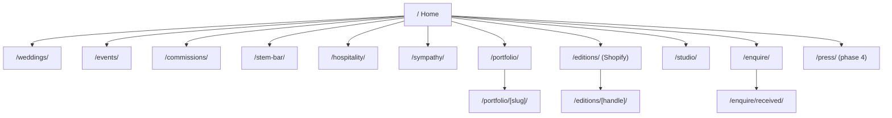
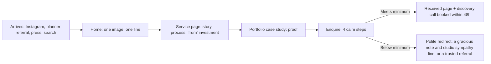

# SB Floristry: Luxury Pivot Audit & Roadmap

Audited: all of `src/pages`, `src/components`, `src/layouts`, `src/config`, `src/utils`, `astro.config.mjs`, `tailwind.config.mjs` and `public/images` (5,318 lines across 25 source files).

---

## 1. Executive Diagnostic

> [!CAUTION]
> **Every enquiry form on the site is fake, and leads are being lost right now.**
> - [Layout.astro:211-220](file:///home/jordadmin/Documents/SB%20Floristry/27-10-2026/src/layouts/Layout.astro#L211-L220) catches the submit on `#home-contact-form` (used on Home and `/corporate`), waits 1 second, then shows "Inquiry Received". Nothing is sent or saved.
> - [contact.astro:59](file:///home/jordadmin/Documents/SB%20Floristry/27-10-2026/src/pages/contact.astro#L59) posts to `action="#"`. On a static page, that only reloads the page.
>
> For a business that depends on high-value commissions, fixing this comes before anything else.

| # | Weakness | Evidence in code | Why it hurts the luxury pivot |
|---|---|---|---|
| 1 | **The site is built as a shop, not a studio** | The header has a cart icon, a "Shop" menu built from Shopify tags, and "Gift Picker". There's a shimmering bar saying "Free delivery over £60 • UK Standard £4.99" ([Header.astro:58-60](file:///home/jordadmin/Documents/SB%20Floristry/27-10-2026/src/components/Header.astro#L58-L60)). The homepage's main button is "Shop The Collection". There are floating delivery-truck and WhatsApp buttons. | Within 2 seconds a visitor reads "local florist with delivery". Wealthy clients and planners leave. Bargain buyers stay. |
| 2 | **Low prices are visible everywhere** | Sympathy tributes "From £45 / £65 / £150" ([funerals.astro:66-86](file:///home/jordadmin/Documents/SB%20Floristry/27-10-2026/src/pages/funerals.astro#L66-L86)). The quiz offers budgets of "£40–£60" ([occasion-finder.astro:90](file:///home/jordadmin/Documents/SB%20Floristry/27-10-2026/src/pages/occasion-finder.astro#L90)). Subscriptions start "From £28 a box". The footer offers "10% off your first order". The schema says `priceRange: "££"`. | These prices set a low expectation. A client who has seen "£45" will push back on a £25k quote. |
| 3 | **The visual language feels like a high-street shop** | Bright metallic gold `#D4AF37` with gradient "gold" text, an animated shimmer bar, Font Awesome icons everywhere, slow hero zooms, offset boxes behind images, grayscale hover effects, white cards with shadows. Tiny 10px bold uppercase labels with 0.25em letter spacing appear on nearly every line. | Real luxury brands (Aesop, The Row, Bottega) are quiet: pale neutrals, big type, big photos, no decorative extras. This site is visually loud. |
| 4 | **Messaging and site structure are split across too many businesses** | Retail, subscriptions, hotel/spa contracts, a B2B white-label trade page for funeral directors ([funerals-overflow.astro](file:///home/jordadmin/Documents/SB%20Floristry/27-10-2026/src/pages/corporate/funerals-overflow.astro): "B2B Logistics Division", "0% Retail Self-Promotion"), and weddings, all on one domain. The copy leans on "Family Run", "Romford" and "Free Local Delivery". | There is no single clear brand. The trade page in particular openly describes the studio as a volume supplier. Google indexes it, because the sitemap includes every page. |
| 5 | **No portfolio, no proof** | There are no project case studies, venue names, photographer credits or press mentions. Testimonials are anonymous initials ("James M., Romford"). Six gallery photos are used as backgrounds and never shown as work. | Wealthy clients buy on proof: who you've worked for, where, and with whom. This is the most important missing piece. |

**Technical issues that also cheapen the experience:**
- **Images are hidden until JavaScript runs.** `img { opacity: 0 }` is applied site-wide until a script adds a class ([Layout.astro:96-97](file:///home/jordadmin/Documents/SB%20Floristry/27-10-2026/src/layouts/Layout.astro#L96-L97)). This slows the first image appearing (hurts LCP) and leaves blank areas if the script fails.
- **Page titles repeat the brand name.** Pages pass "… | SB Floristry" and the layout adds it again, giving "… | SB Floristry | SB Floristry".
- **Social sharing and canonical tags are wrong.** `og:url` always points to the homepage, there is no canonical tag, and every page shares the same OG image.
- **Two different phone numbers** appear in the schema (`+447712707849` vs `01708 956609`).
- **Dead placeholder images.** Fallbacks point to `via.placeholder.com`, which no longer works ([index.astro:25](file:///home/jordadmin/Documents/SB%20Floristry/27-10-2026/src/pages/index.astro#L25), CartModal, ProductCard).
- **Images are poorly organised.** They are imported from `../../public/images`, which is the wrong pattern for Astro (images to be optimised belong in `src/assets/`). Most pages use plain `` tags with no width or height. `logo.png` is **783 KB**.
- **Every page waits on Shopify at build time.** `Header.astro` queries Shopify just to build the menu.
- **Inconsistent URLs.** The config sets `trailingSlash: 'always'`, but every internal link leaves the slash off, which causes redirects and mixed URLs.
- **Heavy icon font.** The full Font Awesome CSS is loaded from a CDN to show about 15 icons.
- **Empty footer links.** Social and legal links point to `#`.

---

## 2. Recommended Site Architecture

### 2.1 Sitemap



| Route | Purpose | Replaces |
|---|---|---|
| `/` | Editorial opening: one strong image, one line of text, featured projects, a short note from the founders, and a link to enquire | `index.astro` |
| `/weddings/` | Weddings, estate celebrations and multi-day events. Shows the process, chosen projects and the starting investment | `weddings.astro` |
| `/events/` | Large private and brand events: galas, launches, dinners | `corporate/index`, `corporate/events` |
| `/hospitality/` | Hotels, spas and private members' clubs: statement reception pieces, rolling weekly arrangements, seasonal changeovers, and event work for the venue | `corporate/hotels`, `corporate/spas-wellness` |
| `/commissions/` | VIP, celebrity and editorial work: photoshoots, private homes, residencies, "by appointment" pieces | *new* |
| `/stem-bar/` | Stem Bar experiences for brands and private events: the format, guest experience, logistics, a showreel | *new* |
| `/sympathy/` | **A main pillar.** Tributes, casket designs and memorial installations, written gently. Shows "from" prices at the new levels, a direct phone line and a short enquiry form built for quick turnaround | `funerals.astro` |
| `/portfolio/` + `/portfolio/[slug]/` | Project case studies, filterable by service | `collections/[tag]`, `products/[handle]` |
| `/studio/` | The two founders: their story, approach and standards. Written as a design practice, not a family shop | `our-story.astro` |
| `/enquire/` | Multi-step form that qualifies the client | `contact.astro` + every inline form |
| `/enquire/received/` | Thank-you page: what happens next, when to expect a reply, a link to the portfolio | `success.astro` |

### 2.2 Navigation

```
[ SB FLORISTRY wordmark ]      Services ▾    Sympathy    Portfolio    Editions    Studio      [ Enquire → ]

Services panel (full width, previews an image as you hover each name):
  Weddings · Events · Stem Bar · Hospitality · Commissions
```
- **Desktop:** the wordmark on the left (an SVG, not the 783 KB PNG), four text links with no icons, and **one** outlined "Enquire" button on the right. No cart, no announcement bar, no floating buttons.
- **Sympathy is a top-level link.** Funerals are a pillar you want to grow, and those clients are often under time pressure, so they need to reach it in one click. Its page leads with a phone number and a short form.
- **Hospitality and Stem Bar** sit inside the Services panel, which keeps the main bar short.
- **Mobile:** a full-screen overlay with large serif links, a short staggered fade-in, and the email and phone at the bottom.
- **Footer:** studio email, "By appointment, Essex & London", Instagram, a "Private Client List" signup (no discount), and Privacy and Terms.

### 2.3 Client journey



### 2.4 Phasing out the retail side (in order, without losing revenue or search traffic)

| Element | Action | Notes |
|---|---|---|
| Cart, `CartModal`, `ProductCard`, `/products/*`, `/collections/*` | **Keep the code, switch it off.** Controlled by the `shop` setting in `src/config/features.ts`. While off, the pages aren't built, the cart isn't shown, and nothing appears in the menu or sitemap. | Add 301 redirects to `/portfolio/` that apply only while the shop is off, so old links and search results still land somewhere useful |
| `/occasion-finder` ("AI Gift Advisor") | Retire | 301 to `/` |
| `/subscriptions`, `/success`, `api/gocardless/*`, `utils/shopify.js` | **Keep the code, switch it off.** Controlled by the `subscriptions` setting. While off, the pages aren't built and the GoCardless endpoints return `404`, so they can't be reached from outside. `shopify.js` is changed to fail safely, so a build still works without Shopify credentials. | The Shopify and GoCardless secrets can stay in Cloudflare or be removed. The code works either way |

> [!NOTE]
> **Bringing direct purchases back later.** The shop can return as a small **premium edit**: a few signature pieces or seasonal arrangements, plus **sympathy tributes you can order directly** at the new prices. Sympathy fits buying online well, because people want speed and certainty. Restyled to the new look, this supports the luxury positioning instead of working against it.
| Delivery modal, `delivery.json`, free-delivery bar | Delete | |
| Sympathy price list (£45 / £65 / £150) | Replace with "from" prices at the new levels (see 4.3) | Funerals stay quick to order, but are presented and priced as premium |
| `/corporate/funerals-overflow` | **Keep as a private trade page:** move it to `/trade/funeral-directors/`, mark it `noindex`, take it out of the sitemap and navigation, and restyle it to the new look. Send the link directly to funeral directors. | It brings in steady funeral work, but shouldn't be what the public or search engines see |
| "10% off" newsletter | Change to "Private Client List: seasonal notes & studio availability" | |

### 2.5 Editions: the premium shop

**Recommendation:** put it on the **same domain** as its own section, `/editions/`, with a separate layout. Shopify holds the products and runs the checkout. Do **not** use a separate Shopify-themed store.

| Option | Verdict |
|---|---|
| Separate Shopify store theme at `shop.…` | ❌ The look splits in two, the design has to be maintained twice, search ranking is split across two sites, and it looks like a generic Shopify theme |
| **`/editions/` section inside the Astro site, Shopify behind it** | ✅ One brand and one design system. Search ranking builds on one domain. Shopify still handles payments, Apple Pay and Google Pay, taxes and orders |

**Why "Editions":** it suggests small, limited runs. That suits a two-person studio, where limited capacity becomes a selling point. It also covers both groups of products:
- **Signature Editions:** 6–10 arrangements, refreshed each season
- **Sympathy Editions:** tributes you can order directly at the new prices

The `/sympathy/` page links to both: "Order a tribute" for the Editions, and "Commission something bespoke" for an enquiry. Other names that would work: *Atelier*, *The Edit*, *Collection*.

**What keeps the shop feeling premium:**
- **A small range with a high price floor:** no more than about 12 products, no filters, sorting, sales, star ratings or discount codes. Prices start around £150+.
- **Calm product pages:** 3–5 large photos including the packaging, a short note on the design, and wording like "Order" or "Reserve" instead of a loud "Add to Basket".
- **Daily capacity as stock:** set a limit, for example 8 Editions per day. When it's full, the page says "Fully reserved for this date". That's genuine scarcity and protects the team's time.
- **Simple, personal delivery:** "Hand-delivered by the studio" at one flat premium fee per zone (Essex, Central London). No free-delivery thresholds. A delivery date picker that respects lead times and cut-off times, plus a card message.
- **Branded checkout:** Shopify's checkout editor sets the logo, colours and fonts. Connecting `shop.sbfloristry.co.uk` to Shopify means checkout shows your domain instead of `sb-floristry.myshopify.com`.

**How it's built:**
- **Products:** pulled from **Shopify collections** (not tags, as now) when the site is built. A Shopify product-update webhook triggers a Cloudflare rebuild, so changes appear within minutes.
- **Live stock:** checked in the browser on product pages, so a fully reserved date shows immediately.
- **Cart:** rewritten to use the **Shopify Storefront Cart API** (`cartCreate`, then `checkoutUrl`). The current `/cart/variant:qty` link can't reliably carry the delivery date and card message. With the Cart API they travel as cart attributes and line-item properties.
- **On/off:** the existing `shop` setting turns the whole section on or off. Old `/products/*` and `/collections/*` links redirect to `/editions/`.
- **Code reuse:** `shopify.js` and the GoCardless code are kept. `CartModal` becomes `CartDrawer`, and `ProductCard` becomes `EditionTile`.

> [!NOTE]
> The Shopify Storefront token is currently hard-coded in `shopify.js` and `CartModal.astro`. It's a public read-only token, so the risk is low, but it should move to environment variables.

---

## 3. UI/UX & Editorial Standards

### 3.1 Design tokens (proposed)

| Token | Current | Proposed | Notes |
|---|---|---|---|
| Background | `#F9F8F6` cream / `#0a0a0a` black | **Bone `#F3EFE8`**, Paper `#FAF8F4` | Warm and quiet. Dark sections only for occasional dramatic moments |
| Text | `#1A1A1A` | **Ink `#1B1A17`**, Stone `#6F675E` for secondary text | Softer contrast that still passes AA |
| Accent | `#D4AF37` metallic gold | **Antique bronze `#8A6A45`**, used for under 2% of the page | Thin rules and link underlines only. No gradients |
| Display font | Playfair Display | **Cormorant Garamond** ✅ confirmed (free) | Self-host with `@fontsource` instead of Google Fonts |
| Body font | Lato | **Inter** ✅ confirmed (free), weight 300–400 | Self-host with `@fontsource` |
| Label style | 10px bold, 0.25em tracking, everywhere | 11–12px regular, 0.12em tracking, **only** for section numbers and captions | Fewer shouting labels |
| Type scale | Ad hoc (`text-5xl` to `text-9xl`) | Fluid `clamp()` scale with 7 steps | Defined once in tokens |
| Spacing | `py-24` everywhere | 8px base with section rhythm of 160 / 240px on desktop | Use whitespace as part of the design |

### 3.2 Patterns to remove
- Metallic gradient text, the shimmer bar, hero zoom loops, offset boxes behind images, grayscale hover filters, `shadow-xl` cards
- Every Font Awesome icon (leaf, dove, handshake, magic wand, truck). Use plain words or a thin custom SVG line instead
- Centred text with three-line headings over dark overlays at 50–70% black. Let the photography show
- 4-column equal-height card grids, which read as a product listing

### 3.3 Patterns to introduce
- **An editorial grid:** 12 columns, uneven placement (for example a 7/5 image split, captions in a narrow side column), images bleeding to the edge next to small blocks of text
- **Magazine-style captions:** "Project — Venue — Season — Photography by …"
- **Numbered chapters** ("I. The Ceremony") in place of bold uppercase labels
- **Gentle motion:**
  - Images revealed with `clip-path` as you scroll (CSS scroll-driven animation, with an IntersectionObserver fallback)
  - Link underlines that draw in
  - Page-to-page transitions from portfolio grid to case study, using the `ViewTransitions` already in place
  - Everything respects `prefers-reduced-motion`
- **Selective images:** at most 1 hero and 6–10 portfolio shots per page, consistent colour grading, AVIF/WebP with `srcset`

---

## 4. Client Qualification Funnel

### 4.1 Current state
- **Forms:** three separate forms (Home, Contact, Corporate) asking for Name, Email, Date, Interest and Message. None of them send anything.
- **Qualification:** none. No budget, venue, guest count or vision questions.
- **Tone:** "Let's Create Something Beautiful… or simply wish to order a bespoke arrangement". This openly invites small orders.

### 4.2 Proposed `/enquire/` flow (one page, 4 steps, works without JavaScript)

| Step | Fields | Qualification logic |
|---|---|---|
| **I. The Occasion** | Service: Wedding / Private or Brand Event / Stem Bar / Hospitality / Commission / Sympathy | Sets which minimum applies and which questions follow |
| **II. The Details** | Date (or "flexible / season"), venue name and town, guest count, planner name (optional) | Rejects past dates. Flags dates within 6 weeks as "short notice" |
| **III. Investment** | Floral budget as a radio list. Each service shows its own bands, starting at its minimum | Picking "below minimum" shows a polite note instead of an error |
| **IV. The Vision** | 3–5 mood words (chips), Pinterest or Drive link, free-text "Tell us about the atmosphere", how they found us | Higher-quality briefs. Shows where referrals come from |
| **Contact** | Name, email, phone, preferred contact method | Honeypot field plus Cloudflare Turnstile |

**Prices are kept in one file.** Every "from" price and budget band lives in `src/config/services.ts`. The pages, the form and the lead scoring all read from it, so prices can change without touching page code.

**Sympathy has its own short path.** Choosing Sympathy in step I goes to a single short step instead of the four: funeral date, funeral director, type of tribute, colours or favourite flowers, budget band, and phone number. A "Call the studio" button sits beside it. These clients need speed and warmth, not screening.

**Server side:**
- **Endpoint:** `src/pages/api/enquire.ts` with `export const prerender = false`. This runs on the existing Cloudflare hybrid setup.
- **Validation:** check the input with Zod.
- **Scoring:** compute a lead tier (A/B/C).
- **Email:** send through Resend or Postmark with a subject like `[A] Wedding · 14 Jun 2027 · Hedingham Castle · £40–75k`.
- **Copy for the CRM:** optionally push to Notion, Airtable or HoneyBook.
- **Auto-reply:** a white-glove response with the founders' names, a 48-hour reply promise and a link to the portfolio.

### 4.3 Pricing framework (a starting point to refine)

> [!IMPORTANT]
> These are suggested **launch** figures, not market research. Before going live, compare them with 3–5 studios you'd like to be compared with, and raise them as the portfolio grows. With a two-person team, **time is your limit**. Price each job by how much of the week it takes, not just by the cost of the flowers.

**Rule of thumb for quoting:**
- Flowers and sundries at cost, marked up about 3×
- Plus design time at a day rate per person
- Plus installation and clear-down
- Plus delivery and mileage

If a job uses a full weekend for both of you, its total must justify turning down everything else that weekend.

| Service | Suggested launch "from" | Budget bands in the form |
|---|---|---|
| Weddings | **£3,500** minimum | £3.5–6k · £6–10k · £10–20k · £20k+ |
| Private & brand events | **£2,500** | £2.5–5k · £5–10k · £10k+ |
| Stem Bar | **£1,500** per half-day activation | £1.5–3k · £3–6k · £6k+ |
| Hospitality | Reception statement piece **from £250/week** (3-month agreement); one-off installations **from £750** | £250–500/wk · £500–1k/wk · £1k+/wk · one-off |
| Commissions | **£500** | £500–1.5k · £1.5–5k · £5k+ |
| Sympathy | Wreaths **from £225** (large statement wreaths £300+), casket sprays **from £350**, name/letter tributes **from £300**, memorial installations **from £1,000** | Under £300 · £300–600 · £600–1.2k · £1.2k+ |

**On the £150 large wreath:** for the new positioning, that price is probably too low, particularly as she finds funerals quick and easy to make. That speed is an advantage. Keep it, and charge for the quality and the service rather than the time. In practice:
- Liaising directly with the funeral director
- Turning work round within the week
- Matching colours to the person being remembered
- Delivering to the chapel personally

The private trade page brings in steady funeral-director orders alongside these direct customers.

**Tone of voice:** "Each season we accept a limited number of commissions so that both founders are personally involved in every one." This describes capacity in a positive way and filters out bargain hunters without being dismissive.

---

## 5. Codebase & Component Plan

### Keep and refactor
| File | Change |
|---|---|
| `layouts/Layout.astro` | Rename to `BaseLayout.astro`. Remove the cart, delivery modal, floating buttons, image-hiding CSS and fake form script. Move global styles to `src/styles/`. Take `seo` and `schema` props |
| `components/Header.astro` | Rewrite as `SiteHeader.astro`: a fixed list of links, no Shopify call, an accessible mobile overlay (`<dialog>` or `popover`) |
| `components/Footer.astro` | Rewrite as `SiteFooter.astro` |
| `tailwind.config.mjs` | New colours, fonts, type scale and spacing |
| `astro.config.mjs` | Add `redirects` and an updated sitemap `filter`. Confirm the Cloudflare `imageService`. Keep `trailingSlash: 'always'` and fix internal links to match |
| `weddings.astro`, `funerals.astro` → `sympathy.astro`, `our-story.astro` → `studio.astro` | Rebuild using the new components. Most of the copy can be reused after an edit |

### Retire
`Testimonials.astro` (replaced by `PullQuote` + `PressStrip`), `occasion-finder.astro`, `config/delivery.json`, `corporate/*` (split into `/events/` and `/hospitality/`), `contact.astro` (replaced by `/enquire/`).
`funerals-overflow.astro` moves to `/trade/funeral-directors/` as a private, `noindex` page.

### Keep, switched off (one setting each turns them back on)
| Setting | Files kept |
|---|---|
| `shop` | `utils/shopify.js`, `CartModal.astro`, `ProductCard.astro`, `collections/[tag].astro`, `products/[handle].astro` |
| `subscriptions` | `subscriptions.astro`, `success.astro`, `api/gocardless/create-checkout.js`, `api/gocardless/webhook.js` |

These files get the new look only when they're turned back on, so no effort is spent on them now.

### Create
| Component / file | Role |
|---|---|
| `src/styles/tokens.css`, `src/styles/global.css` | Design tokens, base type, motion settings |
| `components/seo/SEO.astro` | Title template, description, canonical, OG/Twitter tags, per-page image, JSON-LD |
| `components/layout/SiteHeader.astro`, `SiteFooter.astro`, `MobileNav.astro` | Header, footer, mobile menu |
| `components/editorial/EditorialHero.astro` | Full-bleed or split hero image with caption |
| `components/editorial/Chapter.astro` | Numbered section heading with optional intro |
| `components/editorial/ImageText.astro` | Uneven image-and-text split (7/5 or 5/7) |
| `components/editorial/PullQuote.astro`, `PressStrip.astro` | Proof: quotes and press mentions |
| `components/editorial/InvestmentNote.astro` | "Commissions begin from…" block |
| `components/editorial/EnquireCTA.astro` | Shared closing call to action |
| `components/portfolio/ProjectCard.astro`, `PortfolioGrid.astro` | Portfolio listing |
| `components/enquire/EnquiryForm.astro`, `Field.astro`, `ChoiceGroup.astro` | Enquiry form building blocks |
| `src/content/config.ts` + `src/content/portfolio/*.md` | Portfolio content collection. Fields: title, service, venue, date, photographer, hero, gallery[], featured |
| `src/assets/images/…` | Move images here from `/public/images` so Astro can optimise them |
| `public/brand/wordmark.svg` | Vector logo to replace the 783 KB PNG |
| `pages/api/enquire.ts` | Enquiry endpoint running server-side on Cloudflare |
| `src/config/services.ts` | One place for service names, "from" prices, budget bands and lead-scoring thresholds |
| `src/config/features.ts` | On/off settings: `shop: false`, `subscriptions: false`. They can be overridden with Cloudflare environment variables |
| `layouts/EditionsLayout.astro`, `components/editions/EditionTile.astro`, `EditionGallery.astro`, `DeliveryDatePicker.astro`, `CartDrawer.astro` | The Editions shop (section 2.5) |
| `pages/editions/index.astro`, `pages/editions/[handle].astro` | Editions pages, built from Shopify collections |

---

## 6. Phase-by-Phase Implementation Plan

### Phase 0: Hotfix (same day)
1. Point the current `contact.astro` form at a real handler, even a temporary one (a stub of `/api/enquire.ts` that sends an email). Remove the fake submit script in `Layout.astro`.
2. Remove the Gift Picker, delivery bar and floating buttons. Add `features.ts` and switch off the shop and subscriptions: hide the cart, skip those pages in the build, make the GoCardless endpoints return 404, and stop the header calling Shopify. All the code stays in place.
3. Fix the repeated title suffix and the two phone numbers.

### Phase 1: Foundations
1. `tokens.css` + `global.css` + Tailwind theme update. Self-host the fonts.
2. `SEO.astro` (canonical, OG, JSON-LD props, `noindex` option).
3. `BaseLayout.astro` (remove the image-hiding CSS and Font Awesome; keep `ViewTransitions`).
4. `SiteHeader` / `MobileNav` / `SiteFooter`.
5. Move images to `src/assets/`, create the SVG wordmark, set up `<Image>`/`<Picture>` with AVIF/WebP.
6. `astro.config.mjs`: redirects map and sitemap filter.

### Phase 2: Editorial component library
`EditorialHero`, `Chapter`, `ImageText`, `PullQuote`, `PressStrip`, `InvestmentNote`, `EnquireCTA`, plus a reveal-on-scroll utility in CSS.

### Phase 3: Content pages
1. Portfolio content collection, `/portfolio/` and `/portfolio/[slug]/` (with view transitions).
2. `/` rebuilt.
3. `/sympathy/` first (the fastest source of revenue), then `/weddings/`, `/events/`, `/hospitality/`, `/stem-bar/`, `/commissions/`, `/studio/`.
4. Restyle the trade page at `/trade/funeral-directors/`.
5. Delete the retired files (Gift Picker, delivery config, old corporate pages) once the redirects are verified. The shop and subscription files are kept.

### Phase 4: Qualification funnel
1. `EnquiryForm` with 4 steps (built on plain HTML form validation and `:user-invalid` styling; JavaScript only adds the step-by-step behaviour).
2. `/api/enquire.ts`: Zod validation, Turnstile, lead scoring, email through Resend or Postmark, auto-reply.
3. `/enquire/received/` and analytics events per step (Plausible or Fathom, without cookies).

### Phase 5: Editions (premium shop)
1. Set up Shopify: collections (Signature, Sympathy), daily capacity as stock, delivery zones, checkout branding, and `shop.sbfloristry.co.uk` as the checkout domain.
2. `EditionsLayout`, `EditionTile`, `EditionGallery`, and the `/editions/` and `/editions/[handle]/` pages.
3. `CartDrawer` using the Storefront Cart API, with delivery date and card message passed as cart attributes.
4. Shopify webhook that triggers a Cloudflare rebuild. Turn on `shop`. Redirect old product URLs.

### Phase 6: Polish & proof
`/press/`, case study write-ups, Lighthouse target ≥ 95 in every category, accessibility check, schema changed to `ProfessionalService` with the correct `areaServed`, local search pages for sympathy (Romford, Brentwood, Hornchurch, Chelmsford).

---

## 7. Open Decisions

| Decision | Status |
|---|---|
| Fonts | ✅ Free: Cormorant Garamond + Inter |
| Hotels & spas | ✅ Their own `/hospitality/` page |
| Funerals | ✅ A main pillar, plus a private trade page for funeral directors |
| Subscribers | ✅ None. GoCardless code kept but switched off |
| Shopify | ✅ Returns as **Editions** (`/editions/`), with checkout on `shop.sbfloristry.co.uk` |
| Pricing | 🟡 Suggested launch figures in 4.3. To refine, kept in `services.ts` |
| Enquiry email | ✅ Resend free tier (3,000 emails/month, 100/day). Enquiries go to the **`studio@sbfloristry.co.uk`** group, with `info@` kept as an alias |
